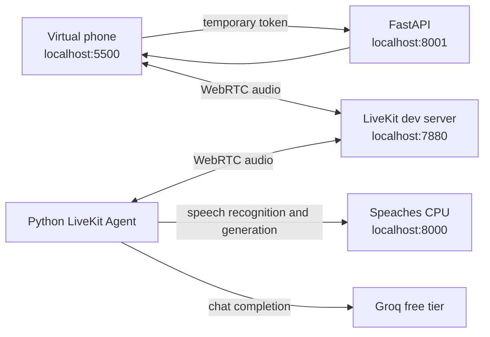

# MAVIS — Local Virtual Hospital Call-Centre Assistant

MAVIS is a free, local prototype of a simulated hospital call-centre voice assistant. Speak to it from a browser virtual phone using WebRTC. The project is intended for a student demonstration and uses fictional callers and scenarios only. It is not medical care; never enter real patient information.

See [docs/PROJECT_PROGRESS.md](docs/PROJECT_PROGRESS.md) for the implementation estimate, completed work, remaining tasks, and verification record. Update it alongside future project changes.

## 📋 Contents

- [Features](#-features)
- [Architecture](#-architecture)
- [Project structure](#-project-structure)
- [Requirements](#-requirements)
- [Installation](#-installation)
- [Download speech models](#-download-speech-models)
- [Run MAVIS](#-run-mavis)
- [Verify and try a call](#-verify-and-try-a-call)
- [API endpoints](#-api-endpoints)
- [Troubleshooting](#-troubleshooting)
- [Current scope](#-current-scope)

## ✨ Features

- Browser-based virtual phone with a keypad, microphone, and audio playback.
- Local WebRTC calls through a self-hosted LiveKit development server; no SIM, real phone number, SIP provider, or cloud host.
- Local speech recognition and speech generation through Speaches running on CPU in Docker.
- A Python LiveKit Agent that uses Groq's free tier for chat responses. The language-model request is the only application data sent outside the computer.
- FastAPI service that creates a room and short-lived browser token using a synthetic caller ID.
- Local smoke check for service connectivity, speech round trip, Groq, and token creation.

## 🏗️ Architecture



The browser requests a temporary room token from the local API. The browser and agent join that room on the local LiveKit server. The agent uses Speaches for speech-to-text and text-to-speech, and Groq for the conversational response. See [docs/architecture.md](docs/architecture.md) for details.

## 📁 Project structure

```text
MAVIS/
├── agent/
│   ├── agent.py                 # LiveKit voice agent and conversation prompt
│   └── requirements.txt         # Agent dependencies
├── api/
│   ├── server.py                # Health check and call-token API
│   └── requirements.txt         # API dependencies
├── docs/architecture.md         # Audio and token flow
├── scripts/
│   ├── start-livekit.*          # Start the local LiveKit dev server
│   ├── start-speaches.*         # Start Speaches CPU in Docker
│   ├── run-app.*                # Open the web, API, and agent processes
│   └── smoke_test.py            # Check local service connections
├── tools/                       # Optional local LiveKit server binary
├── web/index.html               # Browser virtual phone
├── .env.example                 # Safe configuration template
└── README.md
```

## 💻 Requirements

- Python 3.11 or newer.
- Docker Desktop (Windows/macOS) or Docker Engine (Linux), running.
- A Groq API key with free-tier access. Store it only in the ignored root `.env` file.
- A LiveKit server binary for your operating system. This workspace includes `tools/livekit-server.exe` version 1.13.7 for Windows; other platforms can get the matching binary from [LiveKit Server releases](https://github.com/livekit/livekit/releases).
- Internet access for initial Python package and model downloads, and for loading the pinned LiveKit browser client bundle.

## ⚙️ Installation

Run commands from the MAVIS project root.

### Windows (PowerShell)

```powershell
Copy-Item .env.example .env
# Edit .env and set GROQ_API_KEY. Keep the model IDs from the template.
py -3.11 -m venv .venv
.\.venv\Scripts\Activate.ps1
python -m pip install --upgrade pip
python -m pip install -r agent/requirements.txt -r api/requirements.txt
```

If PowerShell blocks environment activation, call the environment's Python directly as shown in [Run MAVIS](#-run-mavis). The `.venv` folder and `.env` are ignored by git.

### macOS / Linux

```sh
cp .env.example .env
# Edit .env and set GROQ_API_KEY. Keep the model IDs from the template.
python3.11 -m venv .venv
. .venv/bin/activate
python -m pip install --upgrade pip
python -m pip install -r agent/requirements.txt -r api/requirements.txt
```

Install the LiveKit server binary for your OS and make it available as `livekit-server` on `PATH`. Docker must be running before you start Speaches.

## 🗣️ Download speech models

Speaches downloads models explicitly. Start it first (see the next section), then use a second terminal to list the exact IDs supported by the running registry and install the configured speech-recognition and speech-generation models.

### Windows (PowerShell)

```powershell
Invoke-RestMethod 'http://localhost:8000/v1/registry?task=automatic-speech-recognition'
Invoke-RestMethod 'http://localhost:8000/v1/registry?task=text-to-speech'
Invoke-RestMethod -Method Post 'http://localhost:8000/v1/models/Systran/faster-whisper-small'
Invoke-RestMethod -Method Post 'http://localhost:8000/v1/models/speaches-ai/Kokoro-82M-v1.0-ONNX'
Invoke-RestMethod 'http://localhost:8000/v1/models'
```

### macOS / Linux

```sh
curl 'http://localhost:8000/v1/registry?task=automatic-speech-recognition'
curl 'http://localhost:8000/v1/registry?task=text-to-speech'
curl -X POST 'http://localhost:8000/v1/models/Systran/faster-whisper-small'
curl -X POST 'http://localhost:8000/v1/models/speaches-ai/Kokoro-82M-v1.0-ONNX'
curl 'http://localhost:8000/v1/models'
```

The configured Kokoro voice is `af_heart`. If the default Whisper model is too slow, select an available `tiny.en` or `base.en` model from the registry and set `STT_MODEL` in `.env` to its exact ID. The Docker volume `mavis-speaches-cache` persists downloaded models. Registry contents can change with the Speaches image; check the running service before changing model IDs or voice settings.

## 🚀 Run MAVIS

Start each component in its own terminal from the project root. Wait for LiveKit and Speaches to start before starting the API, agent, and browser server.

### Windows (PowerShell)

**Terminal 1 — LiveKit**

```powershell
./scripts/start-livekit.ps1
```

**Terminal 2 — Speaches**

```powershell
./scripts/start-speaches.ps1
```

**Terminal 3 — Call-token API**

```powershell
.\.venv\Scripts\python.exe -m uvicorn api.server:app --host 127.0.0.1 --port 8001
```

**Terminal 4 — Voice agent**

```powershell
.\.venv\Scripts\python.exe agent\agent.py dev
```

**Terminal 5 — Browser phone**

```powershell
.\.venv\Scripts\python.exe -m http.server 5500 --directory web
```

Alternatively, after starting LiveKit and Speaches, `./scripts/run-app.ps1` opens the API, agent, and web server in separate PowerShell windows.

### macOS / Linux

Use one terminal per process:

```sh
sh scripts/start-livekit.sh
sh scripts/start-speaches.sh
.venv/bin/python -m uvicorn api.server:app --host 127.0.0.1 --port 8001
.venv/bin/python agent/agent.py dev
.venv/bin/python -m http.server 5500 --directory web
```

Alternatively, after starting LiveKit and Speaches, run `sh scripts/run-app.sh` to open the API, agent, and web server processes.

The LiveKit development server uses the built-in `devkey` / `secret` configuration for local development. Do not expose it to a network.

## ✅ Verify and try a call

With the required services running and both Speaches models installed, run:

```powershell
# Windows
.\.venv\Scripts\python.exe scripts\smoke_test.py
```

```sh
# macOS / Linux
.venv/bin/python scripts/smoke_test.py
```

The script reports PASS or FAIL for the LiveKit socket, Speaches model list, speech-to-text round trip, Groq chat request, and `POST /call/start`. The API, LiveKit, Speaches, models, and a working Groq free-tier key must be available for all checks to pass.

For a browser call, open [http://localhost:5500](http://localhost:5500), allow microphone access, and click **Call**. Use a headset to reduce echo. Click **Hang up** to end the call. The local API health endpoint is [http://127.0.0.1:8001/health](http://127.0.0.1:8001/health).

## 📡 API endpoints

| Method | Endpoint | Purpose |
| --- | --- | --- |
| `GET` | `/health` | Check that the local FastAPI service is responding. |
| `POST` | `/call/start` | Create a call room and return a short-lived browser token with a synthetic caller identity. |

The API listens on `127.0.0.1:8001` when started with the command above. It does not provide a public endpoint.

## 🔧 Troubleshooting

| Problem | Check |
| --- | --- |
| API health check fails | Confirm Terminal 3 is running and open `http://127.0.0.1:8001/health`. |
| Agent does not join or greet | Confirm LiveKit and the agent are running; inspect the agent terminal for connection or Groq errors. |
| No audio | Use `localhost`, allow microphone access, click the page if playback is blocked, and confirm both Speaches models are installed. Check Docker and Speaches logs. |
| Speaches model is missing | Query `/v1/models` on the running service and install a model ID from its registry. |
| Groq reports 401, 429, or unavailable model | Check `GROQ_API_KEY`, account model access, and free-tier quota. Model availability can change. |
| Speech recognition is slow | Allow the initial download and warm-up to finish, or choose an available smaller `tiny.en` / `base.en` model in `.env`. |
| Browser client does not load offline | The page loads its pinned LiveKit browser bundle from jsDelivr and needs internet access for that package. |

## 📌 Current scope

MAVIS implements the local phone, token API, LiveKit agent, local speech services, and Groq response path for Stages 1–3. Runtime compatibility with LiveKit and Speaches depends on the installed versions and downloaded models; if those services have not been started, the full call path cannot be verified yet.

The agent's `safety_gate()` is a no-op placeholder. MAVIS has no working emergency detection, medical rules, or clinical decision support. The latency log records framework event timestamps; `llm_response_ready` is the completed assistant message event, not first streamed-token timing.

Stage 4 (audio evaluation, nurse join, and simulated follow-up call flows) has not been implemented. Begin it only after the user explicitly asks to continue.
