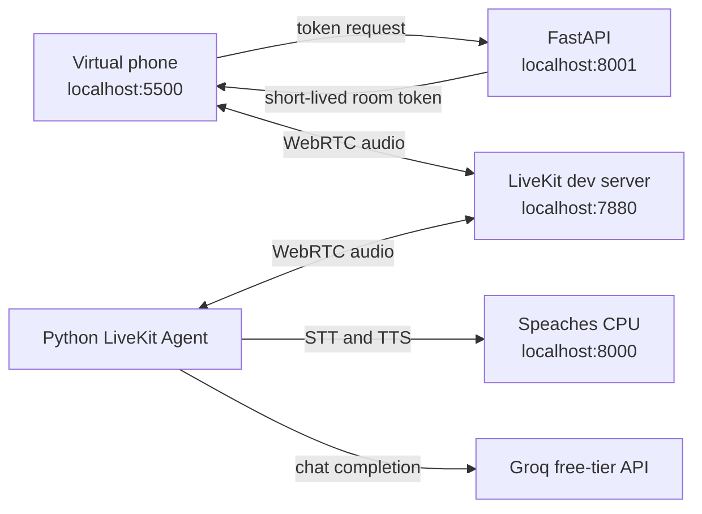

# MAVIS local demo architecture

The browser calls the local API to receive a temporary room token with a fake caller ID. Both browser and agent join the self-hosted LiveKit room. The agent sends captured audio to Speaches for transcription, asks Groq for a short text reply, then sends it to Speaches for speech. Only the LLM request leaves the computer. All caller data in this prototype must be invented.
